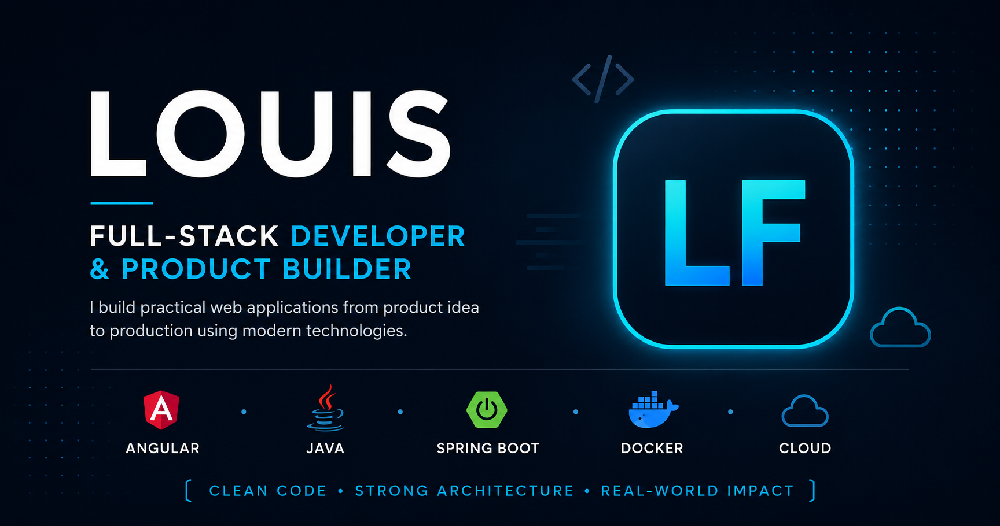

# LF Portfolio

Personal developer portfolio showcasing selected full-stack, product, and open-source projects.

Built with Angular and Tailwind CSS, with a focus on clean architecture, responsive design, project case studies, and production-ready presentation.

## Live Demo

[View Portfolio](https://louis-franck-portfolio.vercel.app/)

## About

I’m a full-stack developer and product builder working primarily with:

- Angular
- TypeScript
- Java
- Spring Boot
- Spring Security
- MySQL
- Docker
- Cloudflare
- Cloud infrastructure
- REST APIs

I build applications from product idea through implementation and deployment.

## Featured Projects

### Studevia
A SaaS platform supporting international students through study and visa preparation workflows.

**Stack:** Angular, Spring Boot, Java, MySQL, Docker, Caddy, Cloudflare, OVH, Stripe, Cloudinary, Brevo, ClamAV

### TSDB — The Streaming Database
A media discovery platform for movies, TV shows, actors, companies, channels, public IPTV sources, and selected legally available streaming content.

**Stack:** Angular, Spring Boot, Oracle Autonomous Database, Redis, Nginx, Cloudflare

### Digital Wedding Invitation Platform
A digital wedding experience with RSVP management, personalized confirmations, QR-based guest check-in, admin tools, email delivery, and PDF generation.

**Stack:** Angular, Firebase, Firestore, Vercel, Resend, Dopio, QR Code, jsPDF

### Anet Patiss
A full-stack business platform for a custom cake and pastry brand, including orders, payments, tracking, reviews, media management, and an admin dashboard.

**Stack:** Angular, Spring Boot, MySQL, Stripe, Cloudinary, Geoapify, Brevo, Cloudflare, OVH

### EUID — Evolutionary Unique Identifier
An open-source high-performance UUID v8 generator for distributed Java systems.

EUID provides time-ordered, topology-aware, decodable identifiers with Base58 support and dedicated JMH benchmarks.

**Repository:**  
https://github.com/louis-franck-moussima/euid-java

## Portfolio Features

- Responsive design
- Project filtering
- Detailed project case studies
- Architecture and deployment visuals
- Open Graph social sharing metadata
- SEO metadata
- Sitemap and robots.txt
- Custom favicon and social preview
- SSR / prerender-ready Angular setup
- Mobile-friendly navigation

## Tech Stack

### Frontend
- Angular
- TypeScript
- Tailwind CSS
- HTML
- CSS

### Backend
- Java
- Spring Boot
- Spring Security
- REST APIs

### Data
- MySQL
- Oracle
- Firebase
- Redis

### Infrastructure
- Docker
- Docker Compose
- Caddy
- Nginx
- Cloudflare
- OVH

### Tools
- Git
- GitHub
- Postman
- Linux

## Local Development

Clone the repository:

```bash
git clone https://github.com/louis-franck-moussima/louis-franck-portfolio
```


### Project Structure
src/app/
├── core/
│   ├── models/
│   └── services/
│
├── data/
│   └── projects.data.ts
│
├── features/
│   ├── home/
│   ├── projects/
│   ├── project-detail/
│   ├── services/
│   ├── about/
│   ├── contact/
│   └── not-found/
│
└── shared/
    └── components/


### Security

This repository does not contain production secrets.

API keys, passwords, tokens, private credentials, and environment-specific configuration should never be committed to the repository.

### Contact

For freelance work, collaboration, or technical opportunities:

LinkedIn: https://www.linkedin.com/in/louis-franck-moussima-489213266
Email: louisfranckm4@gmail.com
GitHub: https://github.com/louis-franck-moussima


### License

This portfolio source code is provided for reference and demonstration purposes.

Project names, branding, screenshots, and project-specific assets may have separate ownership or usage restrictions.


